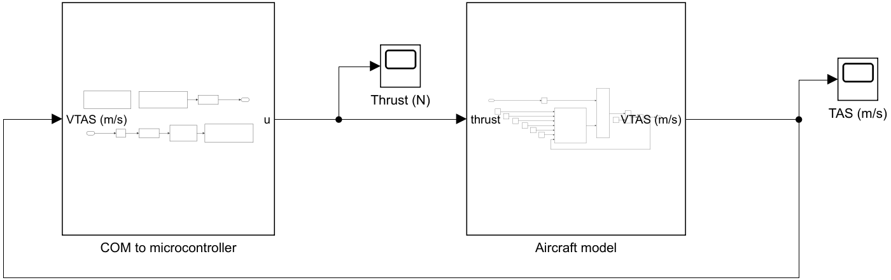
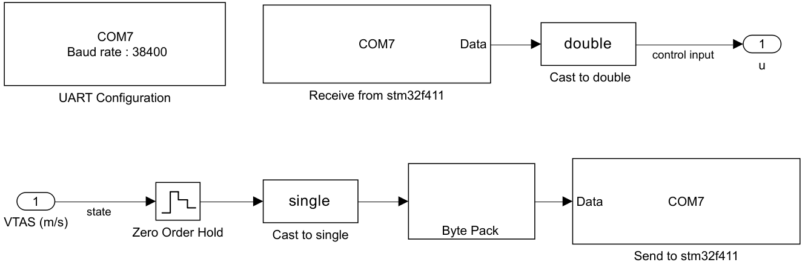
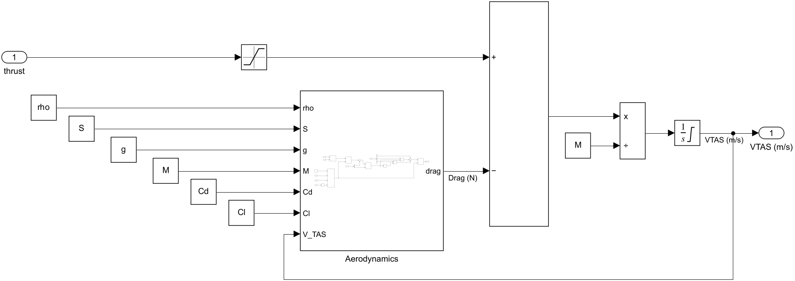

# Bare-metal STM32F411 HIL

Ví dụ mô phỏng **Hardware-in-the-Loop (HIL)** cho vi điều khiển
STM32F411CCU6. Vi điều khiển chạy bộ điều khiển PID, còn mô hình máy bay
được mô phỏng trên MATLAB/Simulink. Hai phía trao đổi dữ liệu qua UART.



## Chức năng

- Lập trình STM32F411 trực tiếp bằng thanh ghi, không sử dụng HAL.
- Nhận vận tốc thật của máy bay (TAS) từ Simulink.
- Tính lệnh điều khiển lực đẩy bằng bộ điều khiển PID trên STM32.
- Gửi lệnh lực đẩy trở lại cho mô hình Simulink.
- Biên dịch và nạp firmware bằng GNU Make và ST-Link, không cần
  STM32CubeIDE.

## Công nghệ và yêu cầu

- STM32F411CCU6.
- GNU Make.
- GNU Arm Embedded Toolchain (`arm-none-eabi-gcc`).
- `st-flash` thuộc bộ công cụ st-link.
- MATLAB/Simulink (mô hình được phát triển với R2021b).
- USB-TTL hỗ trợ mức logic 3.3 V.

Trên Windows với MSYS2, nên mở **MSYS2 UCRT64** rồi chạy các lệnh của dự
án. Các công cụ được sử dụng trong cấu hình hiện tại là:

```text
C:\msys64\usr\bin\make.exe
C:\msys64\ucrt64\bin\arm-none-eabi-gcc.exe
C:\msys64\ucrt64\bin\st-flash.exe
```

Nếu chạy từ PowerShell hoặc terminal tích hợp của VS Code, cần thêm hai
thư mục sau vào `PATH` của Windows:

```text
C:\msys64\ucrt64\bin
C:\msys64\usr\bin
```

Sau khi cập nhật `PATH`, hãy mở terminal mới và kiểm tra:

```powershell
make --version
arm-none-eabi-gcc --version
st-flash --version
```

## Cấu trúc thư mục

```text
.
├── Makefile                    # Biên dịch và nạp firmware
├── STM32F411CCUX_FLASH.ld      # Linker script
├── startup/
│   └── startup_stm32f411xe.s   # Mã khởi động
├── src/
│   ├── main.c                  # UART, PID và vòng lặp điều khiển
│   └── system_stm32f4xx.c      # Cấu hình hệ thống
├── include/                    # Header của ứng dụng và STM32F4
├── drivers/                    # Header CMSIS
└── Simulink/
    ├── uart.slx                # Mô hình HIL
    ├── param_init.m            # Khởi tạo tham số máy bay
    └── get_rho.m               # Tính mật độ không khí
```

## Kết nối phần cứng

Firmware sử dụng USART2:

| STM32F411 | USB-TTL |
|---|---|
| PA2 (USART2_TX) | RX |
| PA3 (USART2_RX) | TX |
| GND | GND |

USB-TTL phải dùng mức logic 3.3 V. Không nối chân 5 V vào chân tín hiệu của
STM32.

## Giao thức UART

- Tốc độ: `38400` baud.
- Dữ liệu: `8N1` (8 bit dữ liệu, không parity, 1 stop bit).
- Byte order: little-endian.
- Mỗi giá trị được truyền là một số thực `float` 32 bit, gồm 4 byte.
- STM32 gửi dữ liệu theo định dạng:

```text
'H' + 4 byte float + '\0'
```

Ký tự `H` là header và `\0` là terminator, giúp Simulink đồng bộ khung dữ
liệu.

## Biên dịch và nạp firmware

Mở terminal tại thư mục chứa README này và chạy:

```bash
# Biên dịch main.elf và main.bin
make

# Xóa các file sinh ra
make clean

# Xóa flash rồi nạp firmware vào địa chỉ 0x08000000
make flash
```

Lệnh `make flash` yêu cầu ST-Link đang kết nối với mạch. Sau khi nạp xong,
ngắt ST-Link trước khi kết nối USB-TTL để chạy mô phỏng UART.

Nếu `make` không tìm thấy compiler, hãy kiểm tra:

```bash
arm-none-eabi-gcc --version
st-flash --version
```

## Chạy mô phỏng Simulink

1. Kết nối USB-TTL theo bảng ở trên.
2. Mở MATLAB và đặt thư mục `Simulink/` vào MATLAB path.
3. Chạy script khởi tạo:

   ```matlab
   param_init
   ```

4. Mở file `Simulink/uart.slx`.
5. Trong các block UART, chọn đúng cổng COM của USB-TTL.
6. Kiểm tra các tham số UART:
   - Baud rate: `38400`
   - Data bits: `8`
   - Parity: `None`
   - Stop bits: `1`
   - Flow control: `None`
   - Byte order: `Little endian`
7. Chạy mô phỏng. Vận tốc thật của máy bay sẽ tiến tới giá trị đặt
   `80 m/s`.

Mô hình gồm hai phần chính:

- **Aircraft model**: mô hình điểm khối của máy bay bay bằng ở độ cao
  `3000 m`.
- **COM to microcontroller**: nhận lệnh điều khiển từ STM32 và gửi TAS
  từ mô hình về STM32.





## Bộ điều khiển PID

Các tham số hiện tại trong `src/main.c`:

```text
TAS tham chiếu: 80.0 m/s
Kp: 500.0
Ki: 30.0
Kd: 10.0
Chu kỳ: 0.1 s
```

Nếu khởi động lại mô phỏng mà không reset STM32, thành phần tích phân có
thể vẫn giữ trạng thái từ lần chạy trước. Nên reset hoặc nạp lại firmware
trước mỗi lần chạy mô phỏng mới.

## Lưu ý

- Firmware hiện dùng bộ dao động HSI nội 16 MHz.
- Nếu thay đổi xung nhịp hoặc bộ chia APB1, cần cập nhật phép tính baud
  rate của USART2 trong `src/main.c`.
- Đây là ví dụ HIL phục vụ học tập và thử nghiệm; cần bổ sung cơ chế
  chống tràn thành phần tích phân, timeout UART và kiểm tra dữ liệu nếu
  dùng trong hệ thống thực tế.

## Giấy phép

Xem file [LICENSE](LICENSE).
